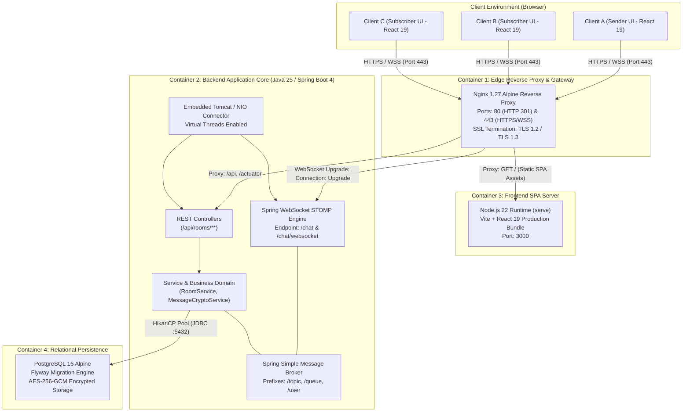
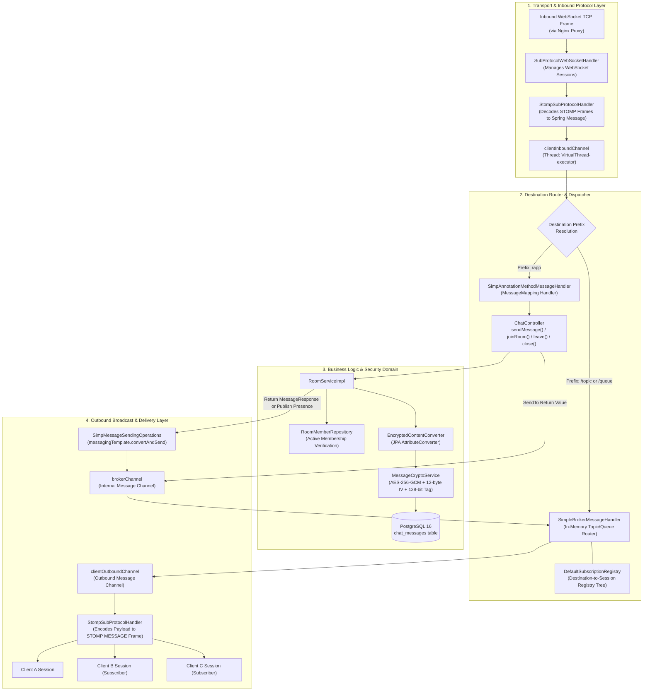
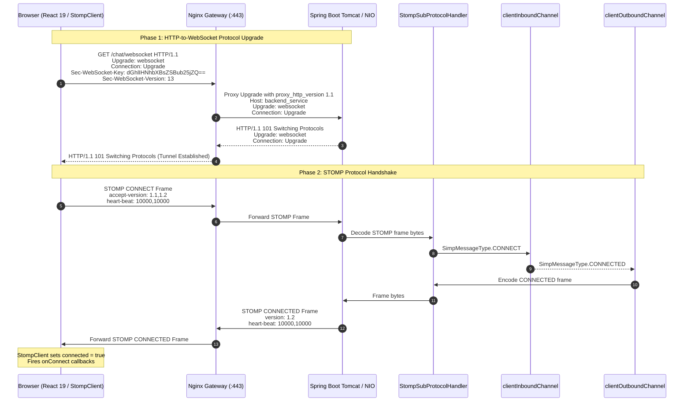
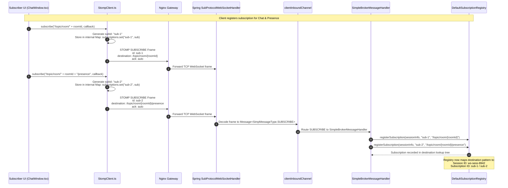
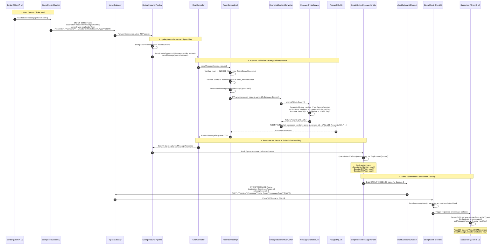
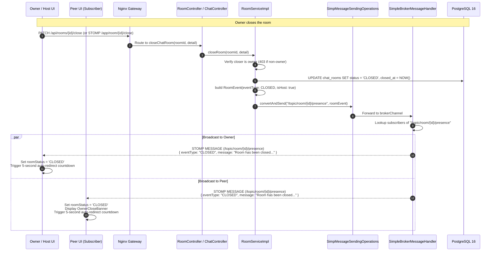
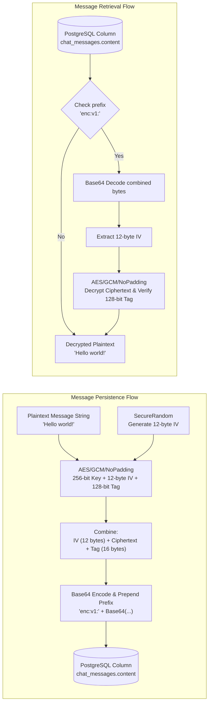
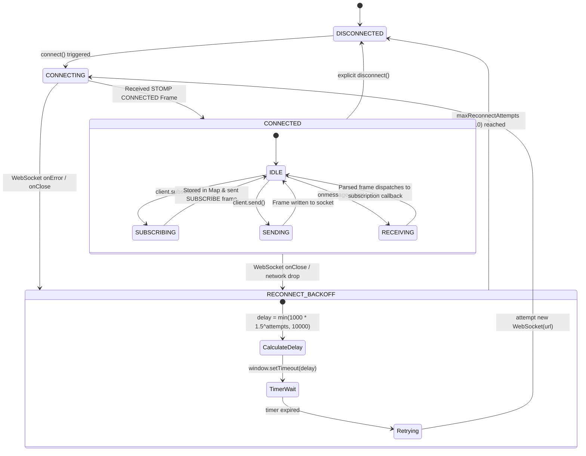

# Open Connect Engine: End-to-End Data Flow Architecture (HLD & LLD)

> **Document Type:** Mixed High-Level Design (HLD) & Low-Level Design (LLD) Specification  
> **Target Scope:** UI Request Lifecycle, Reverse Proxy Routing, WebSocket / STOMP Protocol Handshake, Topic Subscription Mechanics, In-Memory Message Broker Dispatching, AES-256-GCM Encryption, and Subscriber UI Rendering.  
> **Target System:** Open Connect Engine (Spring Boot 4.1.2, Java 25 Virtual Threads, React 19, Nginx Gateway, PostgreSQL 16)

---

## 1. Executive Summary & Architectural Scope

The **Open Connect Engine** provides ephemeral, real-time multi-user communication with strict room-level isolation, end-to-end security at rest, and resilient connection handling.

This document details the lifecycle of all communications across the system:
1. **High-Level Design (HLD):** The macro topology, edge termination, protocol translation, container boundaries, security perimeter, and broker domains.
2. **Low-Level Design (LLD):** The granular internals of the STOMP 1.2 frame pipeline, Spring Framework message channels (`clientInboundChannel`, `clientOutboundChannel`, `brokerChannel`), simple broker subscription registries, thread virtualization, cryptographic transformation (`AES-256-GCM`), and React 19 reactive subscriber state management.

---

## 2. High-Level Design (HLD): System Topology & Component Model

The system operates across four isolated container environments behind an Nginx gateway that terminates SSL and routes traffic dynamically.



### High-Level Component Responsibilities

| Tier / Component | Technology | Primary Responsibilities |
|---|---|---|
| **Client UI** | React 19, TypeScript 5, Vite 8 | Manages user session state, native WebSocket lifecycle, STOMP frame construction, optimistic rendering, typing debounce, and UI countdowns. |
| **Edge Gateway** | Nginx 1.27 Alpine | Terminates TLS (HTTPS/WSS), handles HTTP-to-HTTPS 301 redirects, proxies static SPA requests, applies connection timeouts (`proxy_read_timeout 86400s`), and converts HTTP 1.1 upgrade headers into full-duplex TCP tunnels. |
| **Frontend Static Server** | Node.js 22 (`serve`) | Serves minified single-page application (HTML, CSS, JS) assets to the client browser. |
| **Backend Core** | Spring Boot 4.1.2, Java 25 | Runs on OpenJDK 25 with Virtual Threads (`spring.threads.virtual.enabled=true`). Houses STOMP message broker, REST endpoints, JPA repositories, scheduled room cleaners, and crypto converters. |
| **Message Broker** | In-Memory Simple Broker | Maintains subscription trees (`DefaultSubscriptionRegistry`), resolves active subscribers per topic (`/topic/room/{roomId}` and `/topic/room/{roomId}/presence`), and replicates frames across client sessions. |
| **Database** | PostgreSQL 16 Alpine | Stores persistent room entities, memberships, and chat payloads. Chat messages are protected at rest via authenticated AES-256-GCM cipher encryption. |

---

## 3. Low-Level Design (LLD): Spring WebSocket Messaging Pipeline

The Spring Boot backend architecture decouples network transport, protocol decoding, destination routing, and thread management into distinct asynchronous pipelines.



---

## 4. End-to-End Sequence Diagrams

### 4.1 Connection Establishment & STOMP Handshake Flow

Before any subscription or publishing can occur, the browser establishes a secure WebSocket connection through the Nginx gateway and negotiates the STOMP protocol.



---

### 4.2 Topic Subscription Flow (UI to In-Memory Broker)

When entering a room, the UI client registers subscriptions to receive chat messages and room presence events.



---

### 4.3 Message Dispatch Flow: Sender UI -> Server Processing -> Subscribers

This diagram represents the entire pipeline of a user sending a message until all subscribed peers receive the message and re-render their views.



---

### 4.4 Room Lifecycle & Presence Event Flow (`JOIN`, `LEAVE`, `CLOSE`)

Presence events (when participants join, leave, or the owner closes the room) follow a dedicated lifecycle broadcast to `/topic/room/{roomId}/presence`.



---

## 5. Wire Protocol & Frame Specification

The STOMP (Simple Text Oriented Messaging Protocol) 1.2 format is used across the WebSocket connection. Frames are delimited by a `NULL` byte (`\0`).

### 5.1 Connection Frames

#### Inbound: Client to Server (`CONNECT`)
```stomp
CONNECT
accept-version:1.1,1.2
heart-beat:10000,10000

^@
```

#### Outbound: Server to Client (`CONNECTED`)
```stomp
CONNECTED
version:1.2
heart-beat:10000,10000

^@
```

---

### 5.2 Subscription Frames

#### Client Subscribe to Room Messages
```stomp
SUBSCRIBE
id:sub-1
destination:/topic/room/873f4e22-c23d-4c31-8f51-24db765ba19e
ack:auto

^@
```

#### Client Subscribe to Room Presence
```stomp
SUBSCRIBE
id:sub-2
destination:/topic/room/873f4e22-c23d-4c31-8f51-24db765ba19e/presence
ack:auto

^@
```

---

### 5.3 Publishing Frames

#### Inbound: Send Chat Message (`SEND`)
```stomp
SEND
destination:/app/sendMessage/873f4e22-c23d-4c31-8f51-24db765ba19e
content-type:application/json;charset=UTF-8
content-length:134

{"roomId":"873f4e22-c23d-4c31-8f51-24db765ba19e","senderId":"4a92c101-0982-4112-92a1-128a3f8901b2","content":"Hello world!","type":"CHAT"}^@
```

#### Inbound: Send Typing Indicator (`SEND`)
```stomp
SEND
destination:/app/sendMessage/873f4e22-c23d-4c31-8f51-24db765ba19e
content-type:application/json;charset=UTF-8
content-length:128

{"roomId":"873f4e22-c23d-4c31-8f51-24db765ba19e","senderId":"4a92c101-0982-4112-92a1-128a3f8901b2","content":"...","type":"TYPING"}^@
```

---

### 5.4 Delivery Frames

#### Outbound: Broadcast Message to Subscribers (`MESSAGE`)
```stomp
MESSAGE
destination:/topic/room/873f4e22-c23d-4c31-8f51-24db765ba19e
content-type:application/json
subscription:sub-1
message-id:msg-382910-18
content-length:412

{
  "id": "e2f18392-5819-42b7-9ce2-90184bda2819",
  "roomDetail": {
    "id": "873f4e22-c23d-4c31-8f51-24db765ba19e",
    "roomCode": "849201",
    "roomName": "Dev Room",
    "description": "General discussions",
    "owner": "alice",
    "roomStatus": "OPEN"
  },
  "userDetail": {
    "id": "4a92c101-0982-4112-92a1-128a3f8901b2",
    "username": "alice"
  },
  "content": {
    "message": "Hello world!",
    "messageType": "CHAT"
  },
  "sentAt": "2026-10-31T20:50:00.124Z"
}^@
```

#### Outbound: Broadcast Presence Event to Subscribers (`MESSAGE`)
```stomp
MESSAGE
destination:/topic/room/873f4e22-c23d-4c31-8f51-24db765ba19e/presence
content-type:application/json
subscription:sub-2
message-id:msg-382910-19
content-length:336

{
  "roomId": "873f4e22-c23d-4c31-8f51-24db765ba19e",
  "roomCode": "849201",
  "userId": "9bc12844-3291-4c12-a108-72410a827110",
  "username": "bob",
  "eventType": "JOINED",
  "message": "bob joined the room.",
  "timestamp": "2026-10-31T20:50:02.810Z",
  "roomStatus": "OPEN",
  "isHost": false,
  "isHostOnline": true,
  "memberCount": 2
}^@
```

---

## 6. Cryptographic Security Data Flow (AES-256-GCM at Rest)

The application secures message contents at rest using Galois/Counter Mode (AES-GCM), ensuring both confidentiality and authenticity.



### Encryption Parameters
- **Algorithm:** Advanced Encryption Standard (`AES`)
- **Cipher Transformation:** `AES/GCM/NoPadding`
- **Key Derivation:** SHA-256 digest of secret key configured in `security.chat.encryption.secret-key`
- **IV (Initialization Vector):** 12 bytes generated cryptographically per message (`SecureRandom`)
- **Authentication Tag Length:** 128 bits
- **Storage Envelope:** `enc:v1:<Base64(IV + Ciphertext + Tag)>`

---

## 7. Client-Side Low-Level Implementation (React 19 & StompClient)

The frontend client encapsulates the WebSocket connection state machine and provides automatic reconnections without external third-party STOMP libraries.



### Key Client Invariants
1. **Idempotent Subscription Management:** Calling `subscribe()` with an existing destination updates the active callback rather than creating duplicate wire subscriptions.
2. **Auto-Resubscription on Reconnect:** When the WebSocket connection drops and recovers, `StompClient` automatically iterates over `subscriptions.values()` and re-issues `SUBSCRIBE` frames for all active topics.
3. **Typing Throttle:** Client typing indicators are throttled with a 1.5-second minimum interval between frames to avoid network congestion.
4. **Presence Decoupling:** Message and presence topics are segregated. Presence notifications (`JOINED`, `LEFT`, `CLOSED`) are published to `/topic/room/{roomId}/presence` and do not trigger duplicate message entries.
5. **Deduplication:** The UI applies client-side deduplication using `message.id` to prevent duplicate renders from concurrent REST history fetches and live WebSocket broadcasts.

---

## 8. Network Configuration & Production Resilience

### Nginx Gateway Configuration Summary
- **Proxy Buffering Disabled:** `proxy_buffering off;` ensures sub-millisecond WebSocket frame forwarding without proxy latency.
- **Connection Keep-Alive:** `proxy_read_timeout 86400s;` and `proxy_send_timeout 86400s;` prevent long-lived idle WebSocket sessions from being prematurely severed by the proxy.
- **Health Probing:** Nginx exposes `/healthz`, and proxies `/actuator/health` to allow the React SPA to continuously monitor backend service availability.

### Automated Room Cleanup Engine
- A Spring Scheduled task (`RoomCleanupService`) queries unclosed rooms exceeding the configured TTL (default 24h) via index `idx_chat_rooms_status_created`.
- Stale rooms are marked as `CLOSED` in batches of 100, and a final presence notification is broadcast to any active connections before the rooms are flagged for historical retention cleanup (default 15 days).

---

## 9. File & Component Cross-Reference

| Layer | File / Symbol | Description |
|---|---|---|
| **Reverse Proxy** | `nginx/nginx.conf` | Edge routing, TLS termination, WebSocket upgrade configuration |
| **Backend Config** | `backend/.../config/WebSocketConfig.java` | Registers `/chat` STOMP endpoint, enables `/topic`, `/queue` brokers |
| **Controller** | `backend/.../controller/ChatController.java` | `@MessageMapping` handlers for chat messages, typing, joins, and leaves |
| **Controller** | `backend/.../controller/RoomController.java` | REST endpoints for room creation, joining, closing, and keyset message history |
| **Service** | `backend/.../service/impl/RoomServiceImpl.java` | Core business logic, presence broadcast, room validation, membership control |
| **Security** | `backend/.../crypto/MessageCryptoService.java` | AES-256-GCM authenticated cipher implementation |
| **JPA Converter** | `backend/.../crypto/EncryptedContentConverter.java` | Automatic encryption and decryption for JPA entities |
| **Frontend Client** | `frontend/.../components/chat/StompClient.ts` | Zero-dependency STOMP 1.2 client over native WebSocket |
| **Frontend UI** | `frontend/.../components/chat/ChatWindow.tsx` | Main chat view, topic subscription hooks, message list & typing states |
| **API Client** | `frontend/.../components/chat/chatApi.ts` | Axios REST client for room management and health checks |
